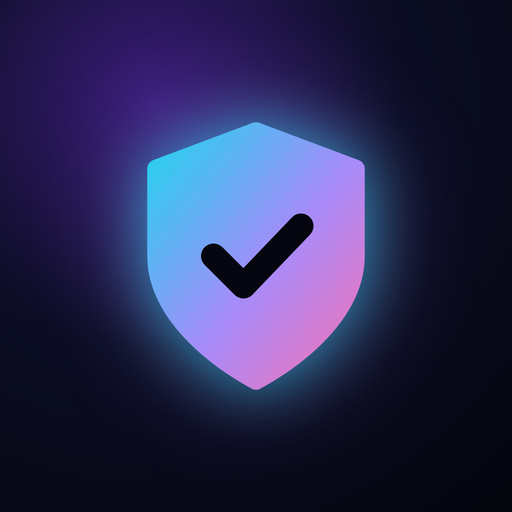
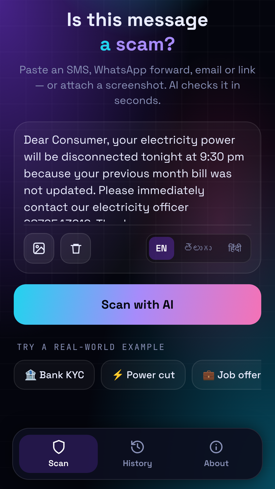
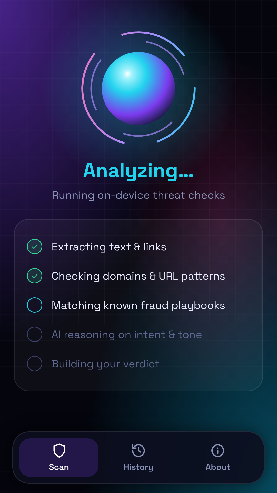
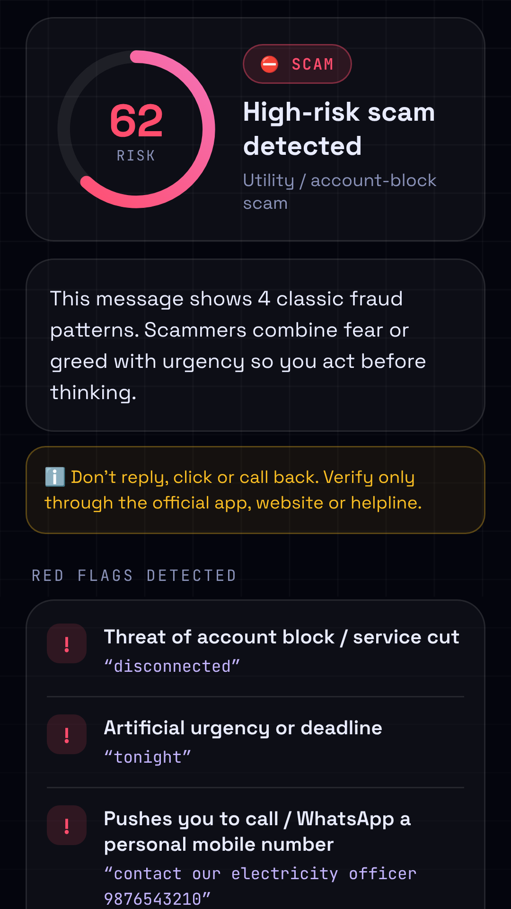

<p align="center"></p>

<h1 align="center">ScamShield AI</h1>
<p align="center">Paste a suspicious SMS, WhatsApp forward or email — AI tells you if it's a scam, shows the exact red flags, and explains what to do. In English, Telugu or Hindi.</p>

<p align="center">
  
</p>

## Why this exists
Indians lose thousands of crores a year to SMS/WhatsApp fraud — fake KYC updates, electricity-cut threats, task-job scams, "digital arrest" calls. ScamShield gives anyone a 10-second second opinion, free, with no sign-up.

## Highlights
- **Hybrid detection**: instant on-device rule engine (URL analysis, lookalike bank domains, shorteners, urgency/OTP/KYC patterns) plus LLM reasoning for intent and tone.
- **Explainable**: a 0–100 risk score, verdict and evidence quoted from the message.
- **Screenshot input**: multimodal AI reads the image.
- **Multilingual output**: English / తెలుగు / हिंदी.
- **Privacy by design**: no accounts, no ads, no analytics, history stored only on the device, and the API key never ships in the app.
- **Secure backend**: Cloudflare Worker proxy with per-device + per-IP rate limiting, input validation, prompt-injection guard and no request logging.
- **Futuristic UI**: animated AI orb (Reanimated), glassmorphism, animated risk gauge, haptics.

## Architecture
```
 Phone (Expo / React Native)                 Cloudflare Worker                 Google
 ┌──────────────────────────┐   HTTPS   ┌──────────────────────────┐   ┌──────────────┐
 │ Rule engine (offline)    │──────────▶│ rate limit (device + IP) │──▶│ Gemini API   │
 │ UI · history (on-device) │◀──────────│ validate · prompt · JSON │◀──│ (multimodal) │
 └──────────────────────────┘           └──────────────────────────┘   └──────────────┘
        falls back to the rule engine if the AI is unreachable / rate-limited
```

| Path | What |
|---|---|
| `src/app/` | Screens (Expo Router): home with tabs, result |
| `src/screens/` | Scan, History, About views |
| `src/components/` | Orb, Gauge, glass UI kit, background |
| `src/engine/heuristic.ts` | On-device rule engine |
| `src/engine/ai.ts` | Client for the AI proxy |
| `worker/` | Cloudflare Worker (AI proxy) |
| `docs/privacy.html` | Privacy policy (host on GitHub Pages) |
| `STORE_LISTING.md` | Store copy, data-safety answers |

**Stack:** Expo SDK 58 · React Native 0.88 · TypeScript · Expo Router · Reanimated 4 · react-native-svg · Cloudflare Workers · Gemini API

---

## 1. Run it locally
```bash
npm install
cp .env.example .env          # leave the URL empty to run in "local engine" mode
npx expo start
```
> The Expo Go app in the stores may lag behind SDK 58. If it can't open the project, make a development build (step 3) or try the web build: `npx expo start --web`.

## 2. Deploy the AI proxy (free)
1. Get a Gemini API key at **aistudio.google.com** → *Get API key*.
2. Deploy the worker (needs a free Cloudflare account):
   ```bash
   cd worker
   npm install
   npx wrangler login
   npx wrangler secret put GEMINI_API_KEY     # paste the key
   npx wrangler deploy                        # prints https://scamshield-api.<you>.workers.dev
   ```
3. Put that URL in `.env` as `EXPO_PUBLIC_SCAN_API_URL`, then restart Expo. The badge should switch to **AI ONLINE**.

> ⚠️ **Free tier & privacy:** on Gemini's free tier Google may use submitted content to improve its products. That's fine for a demo. Before real users scan their messages, switch the key's project to the paid tier (Flash models cost very little at this volume) and keep the privacy policy accurate.

## 3. Build installable apps (EAS, in the cloud — no Android Studio/Xcode needed)
```bash
npm install -g eas-cli
eas login
eas init                                          # links the project, adds projectId to app.json
eas env:create --name EXPO_PUBLIC_SCAN_API_URL --value https://scamshield-api.<you>.workers.dev --environment production --environment preview
eas build -p android --profile preview            # APK you can install on your phone directly
eas build -p android --profile production         # .aab for the Play Store
eas build -p ios --profile production             # needs an Apple Developer account
```

## 4. Publish

### Google Play
1. Create a developer account at **play.google.com/console** (one-time US$25 fee, ID verification).
2. Host the privacy policy: push this repo to GitHub → *Settings → Pages → Deploy from branch → `/docs`*. Put your contact email in `docs/privacy.html` first.
3. Create the app → fill in the store listing from `STORE_LISTING.md`, upload graphics from `store/`, and complete the **Data safety**, **Content rating** and **Target audience** forms.
4. Upload the `.aab` (`eas submit -p android` or manually) to **Closed testing**.
5. **New personal accounts:** you need **at least 12 testers opted in for 14 days in a row** before you can apply for production access. Invite friends and colleagues by email or Google Group. Organisation accounts (with a D-U-N-S number) skip this.
6. Apply for production access → review → live.

### Apple App Store
1. Join the **Apple Developer Program** (US$99/year).
2. `eas build -p ios --profile production` then `eas submit -p ios`. EAS handles certificates.
3. In App Store Connect: fill in the listing, App Privacy and review notes from `STORE_LISTING.md`, upload iPhone screenshots (6.9" size) and submit for review.

---

## Roadmap
- [ ] On-device LLM (Gemini Nano on Android, Apple Foundation Models on iOS) for fully offline AI
- [ ] Android share-sheet target: share an SMS straight into ScamShield
- [ ] Play Integrity / App Attest on the proxy to block non-app traffic
- [ ] Voice input and spoken verdicts for elderly users

## License
MIT © Eshwar Parepally
